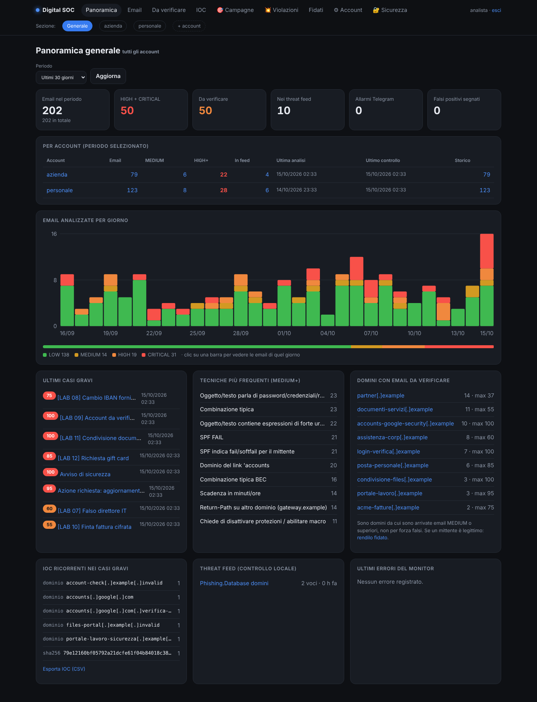
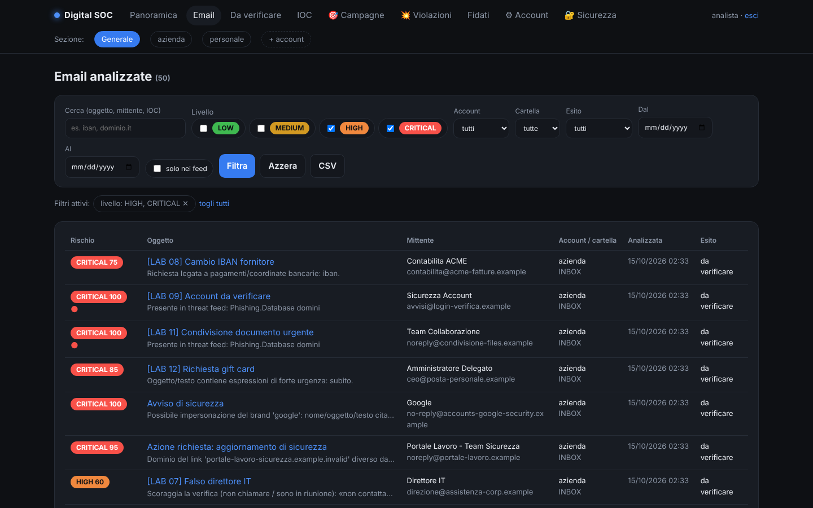
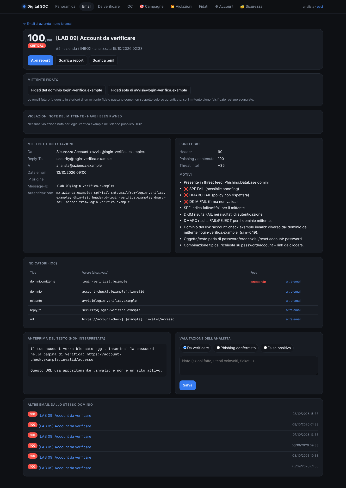

# Digital SOC – Email Analyzer

[](https://github.com/lucapagliarini01-cloud/digital-soc/actions/workflows/tests.yml)

Analyzes a suspicious email (`.eml`) and returns an **explainable risk score**: every point comes with a reason.

🇮🇹 [Versione italiana](README.it.md)



## What it checks

- **Authentication**: SPF, DKIM and DMARC only count when written by a trusted receiving server
  or when the DKIM signature is verified cryptographically. A "pass" never means the email is safe.
- **Body and links**: decodes text and HTML, compares real link targets with the visible text,
  detects forms, hashes attachments (SHA-256). No link is ever opened, no attachment is ever executed.
- **Phishing and BEC**: urgency, requests for credentials or payments, IBAN changes, gift cards, brand impersonation.
- **Open-source threat intel** matched locally: email data never leaves the machine.

| Email list | Detail with reasons and IOCs |
|---|---|
|  |  |

Screenshots use synthetic lab emails only. The interface and the reports are in Italian.

## Usage

```bash
python3 -m venv venv && . venv/bin/activate
pip install -r requirements.txt
python main.py --aggiorna-feed     # download threat feeds (recommended)
python main.py email.eml           # report on screen and as TXT
python main.py email.eml --html    # also as HTML
```

Exit code: 0 LOW, 1 MEDIUM, 2 HIGH, 3 CRITICAL.

## Tests

```bash
python -m unittest discover -s tests -t . -v
```

Only analyze emails you are entitled to analyze.
